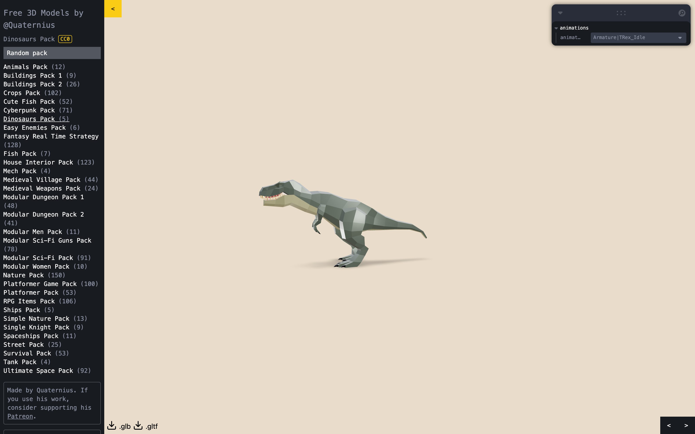
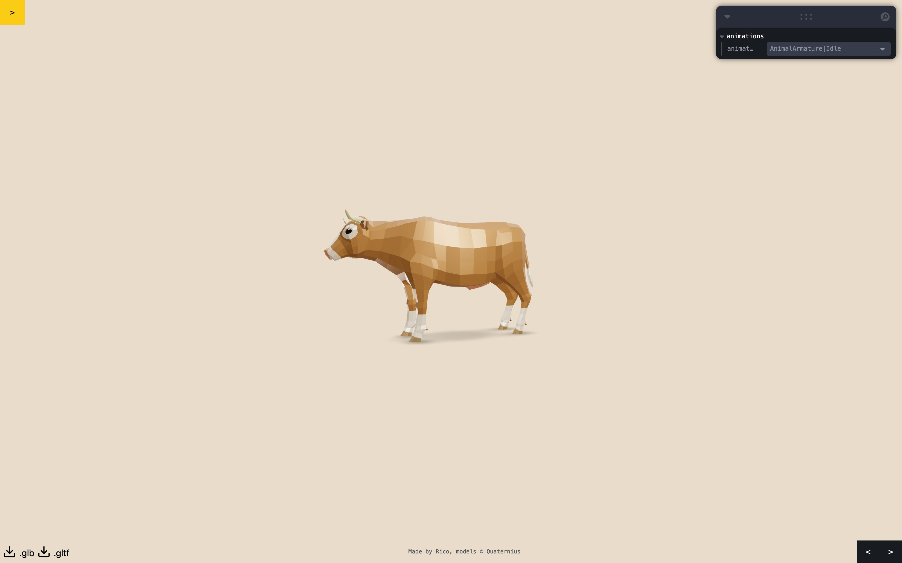
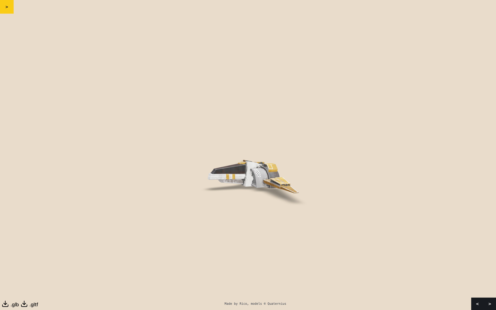
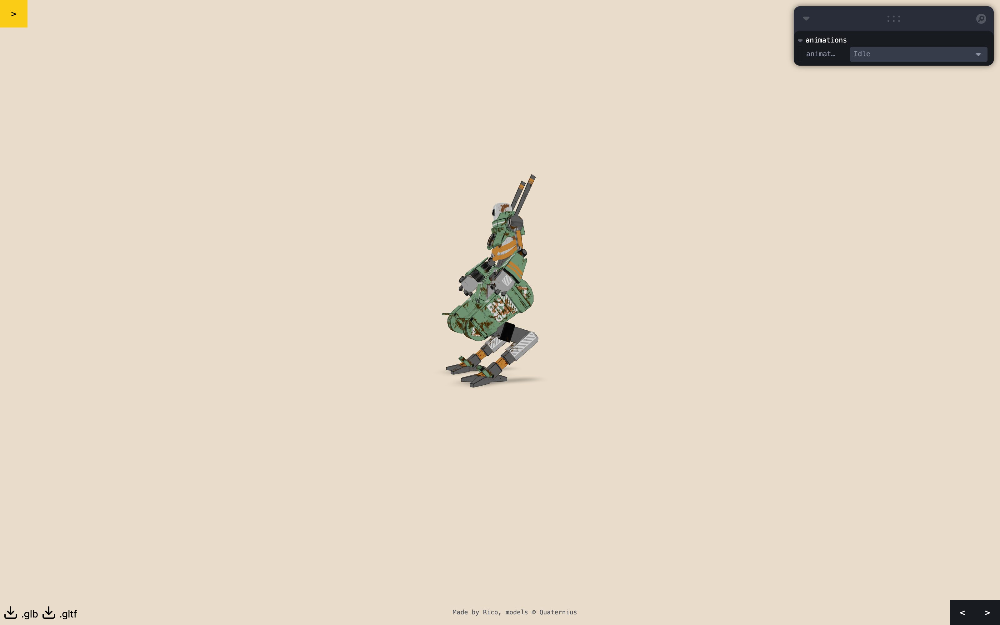

# Quaternius Showcase

[](https://github.com/trebeljahr/quaternius-showcase/actions/workflows/ci.yml)
[-blue.svg)](LICENSE)

> **A fan-made 3D viewer for the free low-poly model packs by [Quaternius](https://quaternius.com). Not affiliated with Quaternius.** All credit for the models goes to Quaternius. This repo's MIT license covers the showcase code only, not the models. See [Licenses](#licenses).

**Look at each model in a free Quaternius pack in 3D before you download it, then save only the `.glb` files you need.**

The site has 32 packs and 1,513 models. Each pack has its own page, for example [`/dinosaurs_pack`](https://quaternius.trebeljahr.com/dinosaurs_pack). The model on screen turns in a live 3D scene, and you can drag to orbit it. Press ← and → to step through the pack, and space to stop or start the rotation. The download buttons save the model on screen as a `.glb` or a `.gltf` file.

Live site: **https://quaternius.trebeljahr.com**



<table>
  <tr>
    <td width="33%"><a href="https://quaternius.trebeljahr.com/animals_pack"></a><br>Animals Pack</td>
    <td width="33%"><a href="https://quaternius.trebeljahr.com/spaceships_pack"></a><br>Spaceships Pack</td>
    <td width="33%"><a href="https://quaternius.trebeljahr.com/mech_pack"></a><br>Mech Pack</td>
  </tr>
</table>

## Licenses

The files in this repo have different licenses:

- The showcase source code is MIT. See [`LICENSE`](LICENSE).
- The model files under `public/glb/` are © Quaternius. Each pack keeps its
  upstream license. [`LICENSES.md`](LICENSES.md) lists the license and the
  source page for each pack.
- The lighting image under `public/hdri/` is by Greg Zaal for Poly Haven. Its
  license is CC0. [`LICENSES.md`](LICENSES.md) names the source.

The MIT license does not cover the models. If you use a model in a project,
follow the license of its pack.

## Run it locally

You need Node.js 24 and pnpm 10.

```bash
pnpm install
pnpm dev
```

The dev server runs on http://localhost:3567. Set `PORT` to use a different
port. The clone is large, because `public/glb/` holds about 186 MB of model
files.

`pnpm build` writes a static export to `out/`, and `pnpm preview` serves it.
`pnpm verify:downloads` checks that every download link points at a file under
`public/`.

## Project structure

```text
src/pages/[id].tsx           One page per pack, built from the pack exports
src/components/quaternius/   One folder per pack, one component per model
src/components/canvas/       The 3D scene, lighting and animation controls
src/components/dom/          Pack list, download buttons, license badge
src/lib/                     Pack licenses, model URLs, page metadata
public/glb/                  The model files, one folder per pack
public/hdri/                 The lighting image
scripts/                     Dev server, sitemap, download-link check, marketing captures
docs/marketing/              Screenshots and social preview cards
```

## Tech stack

- Next.js 15 (pages router) with a static export, React 18 and TypeScript
- react-three-fiber, drei and three.js for the 3D scene, leva for the animation panel
- Tailwind CSS
- Biome for linting and formatting
- Hosted as static files on Cloudflare. [`deploy.yml`](.github/workflows/deploy.yml)
  deploys every push to `main`, and [`ci.yml`](.github/workflows/ci.yml) runs
  `pnpm lint` and `pnpm build` on pull requests.

## Contribute

Pull requests are welcome. Keep each one to a single change. Run `pnpm lint`
and `pnpm build` before you open it. A pre-commit hook runs Biome on the files
you stage.

A change that adds a request to another host, or a new key in the browser's
storage, must update [`src/pages/privacy.tsx`](src/pages/privacy.tsx) in the
same pull request.

Before you add a pack, check the license on its quaternius.com page.
[`LICENSES.md`](LICENSES.md) explains why packs under the Quaternius Asset
License cannot be added.

Good first PRs:

- **Per-pack Open Graph images.** Every pack page shares `public/og-image.png`
  today. A script that renders one image per pack gives each pack its own link
  preview.

To report a broken model or download, open an
[issue](https://github.com/trebeljahr/quaternius-showcase/issues) with the
pack URL and your browser.

## Support

The models are Quaternius's work. To support the artist, see
[patreon.com/quaternius](https://www.patreon.com/quaternius).
