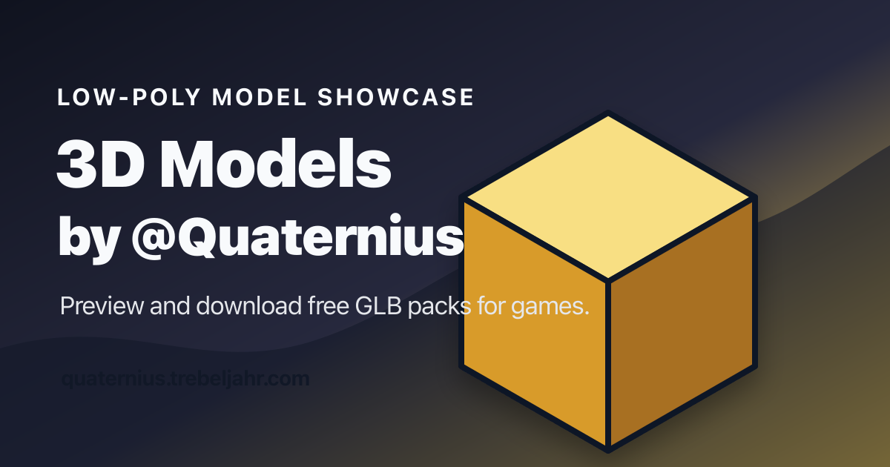

# Quaternius Showcase

Fan-built in-browser 3D viewer for the free low-poly model packs by
[Quaternius](https://quaternius.com). Not affiliated. All credit for the
models goes to Quaternius. This repo's MIT license covers the showcase code
only — see [`LICENSE`](LICENSE) and [`LICENSES.md`](LICENSES.md).

**Look at each model in a free Quaternius pack in 3D before you download it,
then save only the `.glb` files you need.**



Live site: **https://quaternius.trebeljahr.com**

The site has 32 packs and 1,513 models. Each pack has its own page, for
example [`/dinosaurs_pack`](https://quaternius.trebeljahr.com/dinosaurs_pack).
The model on screen turns in a live 3D scene, and you can drag to orbit it.
Press ← and → to step through the pack, and space to stop or start the
rotation. The download button saves the `.glb` file of the model on screen.

## Licenses

Two licenses apply to this repo:

- The showcase source code is MIT. See [`LICENSE`](LICENSE).
- The model files under `public/glb/` are © Quaternius. Each pack keeps its
  upstream license. [`LICENSES.md`](LICENSES.md) lists the license and the
  source page for each pack.

The MIT license does not cover the models. If you use a model in a project,
follow the license of its pack. To support the artist, see
[patreon.com/quaternius](https://www.patreon.com/quaternius).

## Run it locally

You need Node.js 24 and pnpm 10.

```bash
pnpm install
pnpm dev
```

The dev server runs on http://localhost:3567. Set `PORT` to use a different
port. The clone is large, because `public/glb/` holds about 186 MB of model
files.

`pnpm build` writes a static export to `out/`, and `pnpm preview` serves it.
Every push to `main` deploys to Cloudflare through
[`.github/workflows/deploy.yml`](.github/workflows/deploy.yml).

## Contribute

Pull requests are welcome. Keep each one to a single change. Run `pnpm lint`
and `pnpm build` before you open it. A pre-commit hook runs Biome on the files
you stage.

Good first PRs:

- **Per-pack license badge.** Show the upstream license name, for example
  CC0, next to the pack title, and link it to the license page.
- **`.gltf` download** next to the `.glb` button, for packs where Quaternius
  ships a `.gltf` file.
- **Per-pack Open Graph images.** Every pack page shares `public/og-image.png`
  today. A script that renders one image per pack gives each pack its own link
  preview.

To report a broken model or download, open an
[issue](https://github.com/trebeljahr/quaternius-showcase/issues) with the
pack URL and your browser.
